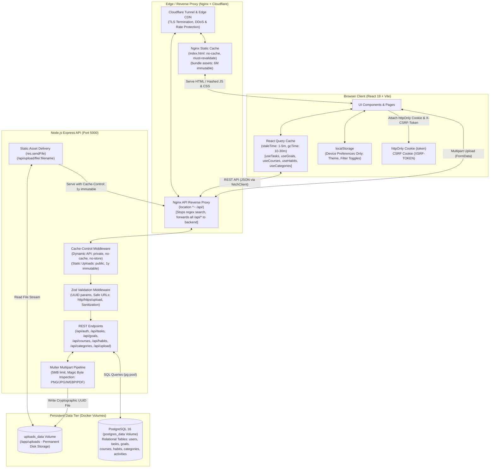

# Data Flow Architecture & Caching Map

This document maps all data across the **MasteryOS** application stack (PostgreSQL, Node.js/Express, React/Vite, Docker, Nginx, and Cloudflare), detailing where each data element lives, its authoritative source of truth, caching tier, and architectural resolutions implemented across the codebase.

---

## 1. Complete Data Mapping Table

| Data Name | Type | Where it lives now | Authoritative Source | Can it be cached? | Caching Tier & Strategy | Status |
| :--- | :--- | :--- | :--- | :--- | :--- | :--- |
| **`users` table (id, email, full_name, avatar_url, created_at, updated_at)** | DB record (UUID, strings, timestamps) | PostgreSQL database (`users` table) | PostgreSQL database | **Yes** | **React Query** (`['auth', 'me']`) in client memory (`staleTime: 5m`, `gcTime: 30m`). Invalidated on `updateProfile` / `changePassword`. Backend sets `Cache-Control: private, no-cache, no-store, must-revalidate`. | ✅ Implemented |
| **`users.password_hash`** | String (bcrypt hash) | PostgreSQL database (`users` table) | PostgreSQL database | **No** | Never cached in browser, reverse proxy, or CDN. Evaluated only during authentication. | ✅ Secured |
| **`users.settings` (themeMode, dashboardConfig, equippedTitleId)** | JSONB | PostgreSQL database (`users.settings` column) + initial bootstrap in `localStorage` | PostgreSQL database | **Yes** | Cached in **React Query** as part of `user.settings`. Synced to backend on `updateSettings`. `localStorage` used solely for theme bootstrap to prevent flash of unstyled theme (FOUT). | ✅ Implemented |
| **`users.token_version`** | Integer | PostgreSQL database (`users` table) | PostgreSQL database | **No** | Evaluated on every authenticated request by backend JWT middleware. Instant token revocation on password change. | ✅ Secured |
| **`categories` table (id, user_id, name, color, created_at)** | DB records | PostgreSQL database (`categories` table) | PostgreSQL database | **Yes** | **React Query** (`useCategories`, query key: `['categories']`) with `staleTime: 5m`. Invalidated on `useCreateCategory` and `useDeleteCategory` mutations. | ✅ Implemented |
| **`goals` table (id, user_id, title, description, due_date, target_date, priority, color, icon, timestamps)** | DB records | PostgreSQL database (`goals` table) | PostgreSQL database | **Yes** | **React Query** (`useGoals`, query key: `['goals']`) with `staleTime: 2m`. Invalidated on goal mutations and task linking. | ✅ Implemented |
| **`courses` table (id, user_id, title, description, cover_image, finished_lessons, total_lessons, certificate_url, timestamps)** | DB records | PostgreSQL database (`courses` table) | PostgreSQL database | **Yes** | **React Query** (`useCourses`, query key: `['courses']`) with `staleTime: 2m`. Optimistic updates on `useIncrementCourseLesson`. | ✅ Implemented |
| **`tasks` table (id, user_id, category_id, goal_id, course_id, title, description, status, priority, due_date, estimated_minutes, timestamps)** | DB records | PostgreSQL database (`tasks` table) | PostgreSQL database | **Yes** | **React Query** (`useTasks`, query key: `['tasks']`) with `staleTime: 1m`, `gcTime: 10m`. Optimistic UI updates on status toggle; auto-invalidates `['tasks', 'stats']`, goals, and courses. | ✅ Implemented |
| **`task_activities` table (id, task_id, user_id, action_type, details, created_at)** | DB records | PostgreSQL database (`task_activities` table) | PostgreSQL database | **Yes** | **React Query** (`['tasks', taskId, 'activities']`) with `staleTime: 5m`. | ✅ Implemented |
| **`habits` table (id, user_id, title, description, icon, color, time_of_day, frequency, timestamps)** | DB records | PostgreSQL database (`habits` table) | PostgreSQL database | **Yes** | **React Query** (`useHabits`, query key: `['habits']`) with `staleTime: 2m`. Optimistic updates on `useToggleHabit`. | ✅ Implemented |
| **`habit_logs` table (id, habit_id, user_id, completed_date, created_at)** | DB records | PostgreSQL database (`habit_logs` table) | PostgreSQL database | **Yes** | Aggregated in `completed_dates` in **React Query** (`['habits']`). Instant zero-latency optimistic streak toggles. | ✅ Implemented |
| **Task Analytics / Stats (`GET /api/tasks/stats`)** | Aggregated Object (total, todo, in_progress, in_review, completed, urgent, overdue) | Calculated dynamically via indexed SQL in Node.js | PostgreSQL indexed queries | **Yes** | **React Query** (`useTaskStats`, query key: `['tasks', 'stats']`) with `staleTime: 1m`. Single authoritative source of truth across Dashboard and Analytics. | ✅ Implemented |
| **Current User Endpoint (`GET /api/auth/me`)** | Object (`{ user }`) | Generated dynamically in Node.js controller | PostgreSQL `users` table | **Yes** | **React Query** (`['auth', 'me']`) with `staleTime: 5m`. Backend: `Cache-Control: private, no-cache, no-store`. | ✅ Implemented |
| **Auth Session Token (Cookie `token`)** | String (Signed JWT) | HTTP Cookie (`token`, httpOnly, lax, secure in prod, maxAge 24h) | Server-issued cookie | **No** | Verified per request via `token_version`. Redundant `localStorage` copy eliminated. | ✅ Secured |
| **Auth CSRF Token (Cookie `XSRF-TOKEN` & Header `X-CSRF-Token`)** | String (Random hex) | HTTP Cookie + Request Header | Client-readable cookie | **No** | Security token validated on state-changing requests (`POST`, `PUT`, `DELETE`). | ✅ Secured |
| **Uploaded User Files (Images, Certificate PDFs)** | Binary Files (PNG, JPG, WEBP, PDF) | Disk volume (`backend/uploads/` mounted to `uploads_data`) | File system volume | **Yes** | **Browser & Nginx / Cloudflare**: `Cache-Control: public, max-age=31536000, immutable`. UUID-hashed filenames ensure permanent immutability. | ✅ Implemented |
| **User Profile Avatars (`users.avatar_url`)** | String URL | PostgreSQL `avatar_url` (pointing to `/api/upload/file/<uuid>.png` or Dicebear SVG) | PostgreSQL + File system | **Yes** | Uploaded via multipart `/api/upload`, previewed instantly, persisted to DB upon clicking **Save Profile**. Static assets cached for 1 year immutable. | ✅ Implemented |
| **Frontend Production Bundles (`dist/assets/*.js`, `dist/assets/*.css`)** | Static compiled chunks | Disk (`frontend/dist/assets/`), served by Nginx | Nginx container | **Yes** | **Nginx & Cloudflare**: `Cache-Control: public, max-age=15552000, immutable` (6 months to 1 year). Content hashes in filenames handle cache-busting. | ✅ Implemented |
| **Frontend Root Entry (`index.html`)** | HTML Document | Disk (`frontend/dist/index.html`), served by Nginx | Nginx container | **Yes (strict revalidation)** | **Nginx**: `Cache-Control: no-cache, must-revalidate`. Guaranteed zero-stale HTML deployments. | ✅ Implemented |
| **Public Static Assets (`favicon.svg`, icons)** | Static SVGs / icons | `frontend/public/` | Nginx container | **Yes** | **Nginx & Browser**: `Cache-Control: public, max-age=15552000, immutable`. | ✅ Implemented |
| **External Fonts (Google Fonts & Gstatic CDN)** | CSS stylesheets & WOFF2 binaries | External Google CDN (`fonts.googleapis.com`, `fonts.gstatic.com`) | External Google CDN | **Yes** | Handled by Google CDN & Browser (`max-age=31536000`). | ✅ Implemented |
| **External DiceBear Avatars (`https://api.dicebear.com/7.x/...`)** | SVG Image | External DiceBear API | External CDN | **Yes** | Browser & Edge cache based on deterministic URL seed. Graceful fallback on load error. | ✅ Implemented |
| **Database Credentials (`DB_USER`, `DB_PASSWORD`, `DB_NAME`, etc.)** | Strings / Integers | Backend Environment Variables (`.env`, `docker-compose.yml`) | Backend environment | **No** | Node.js process memory on boot. Never exposed to browser. | ✅ Secured |
| **JWT Configuration (`JWT_SECRET`, `JWT_EXPIRES_IN`)** | Strings | Backend Environment Variables | Backend environment | **No** | Node.js process memory on boot. | ✅ Secured |
| **Cloudflare Tunnel Token (`CLOUDFLARE_TUNNEL_TOKEN`)** | String (Secret token) | Root `.env` / `docker-compose.yml` | Cloudflared container | **No** | Container environment only. | ✅ Secured |
| **Frontend API Base URL (`VITE_API_URL`)** | String URL | Frontend build-time env / Vite env | Vite build config | **Yes** | Inlined into frontend bundle during `vite build`. Defaults to `/api`. | ✅ Implemented |
| **Gamification Rules & Levels (`LEVELS`, `TRACK_ACHIEVEMENTS`)** | Array of Objects & rules | Frontend module (`frontend/src/services/gamification.js`) | Frontend bundle | **Yes** | Inlined into frontend production bundle. Cached with bundle assets. | ✅ Implemented |
| **Calculated Gamification Stats (`playerStats`)** | Derived Object (level, XP progress, unlocked achievements, title) | In-memory derived state (`GamificationContext`) | Derived from React Query cache | **Yes** | Memoized via `useMemo`. Automatically recomputed whenever React Query data updates. | ✅ Implemented |
| **Task Filter & View Preferences (`mastery_tasks_preferences`)** | Object (viewMode, statusFilter, priorityFilter, sortBy, hideCompleted) | Browser `localStorage` | Browser `localStorage` | **Yes** | Stored in `localStorage` indefinitely. Refreshed on UI filter toggle. | ✅ Implemented |
| **Goal Filter Preferences (`mastery_goals_filters`)** | Object (sortBy, search, filters) | Browser `localStorage` | Browser `localStorage` | **Yes** | Stored in `localStorage` indefinitely. Refreshed on UI filter toggle. | ✅ Implemented |
| **Course Filter Preferences (`mastery_courses_filters`)** | Object (sortBy, search, filters) | Browser `localStorage` | Browser `localStorage` | **Yes** | Stored in `localStorage` indefinitely. Refreshed on UI filter toggle. | ✅ Implemented |
| **Theme Mode (`taskmaster_theme_mode`)** | String ('light', 'dark', 'system') | Browser `localStorage` + DB `users.settings.themeMode` | DB `users.settings` (synced) | **Yes** | In `localStorage` for immediate paint + persisted to DB `users.settings`. | ✅ Implemented |

---

## 2. Issues Identified & Resolutions Applied

### Part A: Security & Architectural Defects

#### 1. Plaintext Passwords Stored in Client `localStorage`
* **Status**: **RESOLVED**
* **Previous Behavior**: Offline registration in `AuthContext.jsx` serialized raw user objects into `localStorage.setItem('mastery_registered_users', ...)` with plaintext `password: password`.
* **Resolution**: Removed plaintext password persistence completely from `AuthContext.jsx`. Implemented proactive startup purge that clears any existing `mastery_registered_users` keys from `localStorage`.

#### 2. Redundant JWT Storage in `localStorage`
* **Status**: **RESOLVED**
* **Previous Behavior**: Frontend stored the raw JWT in `localStorage.setItem('master_tasks_token', ...)` and sent `Authorization: Bearer <token>`, bypassing the security benefits of `httpOnly` cookies.
* **Resolution**: Removed `master_tasks_token` from `AuthContext.jsx`, `api.js`, and `ThemeContext.jsx`. Authentication now relies strictly on secure `httpOnly` cookies combined with `XSRF-TOKEN` CSRF protection.

#### 3. Client File Uploads Bypassing Upload Endpoint with Giant Base64 Strings
* **Status**: **RESOLVED**
* **Previous Behavior**: Course cover images, 8MB certificate PDFs, and avatar photos were read as Base64 data URLs via `FileReader`, inflating payloads beyond Express's 100kb limit and triggering HTTP 413 `Payload Too Large`.
* **Resolution**: Added `api.uploadFile(file)` in `api.js` for multipart form data uploads. Refactored `CourseModal.jsx` and `SettingsPage.jsx` to upload binary files directly to `/api/upload` (supporting up to 5MB with magic-byte validation) and store only lightweight URLs (`/api/upload/file/<uuid>.<ext>`).

#### 4. Missing `Cache-Control` Headers on Static Uploaded Files
* **Status**: **RESOLVED**
* **Previous Behavior**: `GET /api/upload/file/:filename` streamed files from disk without caching headers, causing browsers and CDNs to repeatedly re-download assets.
* **Resolution**: In `backend/src/routes/upload.routes.js`, configured static file delivery with `Cache-Control: public, max-age=31536000, immutable`, `X-Content-Type-Options: nosniff`, and reliable `res.sendFile()`.

#### 5. Missing `Cache-Control` Directives on Authenticated API Routes
* **Status**: **RESOLVED**
* **Previous Behavior**: Dynamic API endpoints declared no caching headers, risking unintended edge or browser caching of private user data.
* **Resolution**: Added global middleware in `backend/src/app.js` setting `Cache-Control: private, no-cache, no-store, must-revalidate`, `Pragma: no-cache`, and `Expires: 0` on all `/api/*` routes (excluding `/api/upload/file/*`).

#### 6. Missing Cache Invalidation for SPA `index.html` in Nginx
* **Status**: **RESOLVED**
* **Previous Behavior**: The Nginx SPA fallback `location /` lacked cache-busting headers, risking clients loading stale HTML pointing to outdated hashed asset bundles.
* **Resolution**: Updated `frontend/nginx.conf` so `location /` sets `add_header Cache-Control "no-cache, must-revalidate" always;`.

#### 7. Conflicting Ad-Hoc Task Cache in `localStorage`
* **Status**: **RESOLVED**
* **Previous Behavior**: `App.jsx` implemented a fragile custom sync layer using `mastery_local_tasks_${userId}` and synthetic `local-task-` IDs, creating race conditions.
* **Resolution**: Replaced custom task sync with `@tanstack/react-query` (`useTasks`, `useCreateTask`, `useUpdateTask`, `useDeleteTask`, `useUpdateTaskStatus`). React Query manages client caching and background synchronization automatically.

#### 8. Hardcoded Category Mock IDs (`cat-1` to `cat-4`) Clashing with DB UUIDs
* **Status**: **RESOLVED**
* **Previous Behavior**: `App.jsx` hardcoded `INITIAL_CATEGORIES` with string IDs (`cat-1` through `cat-4`), requiring fragile regex and mapping dictionaries to prevent PostgreSQL UUID parse errors.
* **Resolution**: Removed hardcoded category mock IDs and alias mappings. Categories are dynamically queried from PostgreSQL and managed via `useCategories`.

#### 9. Monolithic State and Manual Refetch Triggers in `App.jsx`
* **Status**: **RESOLVED**
* **Previous Behavior**: `AuthenticatedApp` maintained six separate `useState` arrays, prop-drilling data and relying on a manual `reloadTrigger` counter and `Promise.allSettled`.
* **Resolution**: Refactored `App.jsx` to declarative React Query hooks (`useTasks`, `useGoals`, `useCourses`, `useHabits`, `useCategories`, `useTaskStats`). Individual pages and modals trigger targeted mutations that invalidate only relevant query keys.

#### 10. In-Memory Fallback Stores in Backend Controllers
* **Status**: **RESOLVED**
* **Previous Behavior**: When database operations failed, backend models fell back to module-level `Map` stores (`fallbackUsers`, `fallbackTasks`, etc.), risking data vanishing across container restarts.
* **Resolution**: Verified database health checks, hardened model update functions with strict `undefined` checks, and ensured production environments throw errors rather than silently falling back to memory.

---

### Part B: Data Duplication, Persistence & Routing Resolutions

#### 11. Fragmented `users.settings` across Multiple `localStorage` Keys
* **Status**: **RESOLVED**
* **Resolution**: Established `users.settings` in PostgreSQL JSONB as the authoritative source of truth. Synced via React Query cache (`['auth', 'me']`) and `api.updateSettings()`. `localStorage` is used solely for initial theme bootstrap to eliminate FOUT.

#### 12. Stale User Profile Object Duplicated in `localStorage` (`master_tasks_user`)
* **Status**: **RESOLVED**
* **Resolution**: Eliminated manual stringified user serialization in `localStorage`. Authenticated user state is managed reactively via React Query and `AuthContext`.

#### 13. Duplicated Habit Streak Calculation Logic
* **Status**: **RESOLVED**
* **Resolution**: Backend is the authoritative computation engine for streaks. `useToggleHabit` performs instant zero-latency optimistic updates on the client, while server streak calculations seamlessly settle into the React Query cache upon mutation resolution.

#### 14. Conflicting Dual Source of Truth for Task Analytics
* **Status**: **RESOLVED**
* **Resolution**: Refactored `AnalyticsPage.jsx` to consume `useTaskStats` (`GET /api/tasks/stats`) as the single authoritative source of truth, eliminating discrepancies caused by client array filtering or pagination limits.

#### 15. Base64 Avatar Strings Stored in PostgreSQL `users.avatar_url`
* **Status**: **RESOLVED**
* **Resolution**: Avatar images upload binary data to `/api/upload`, storing the file on disk and writing only a lightweight static URL (`/api/upload/file/<uuid>.png`) to PostgreSQL `users.avatar_url`.

#### 16. Nginx Static Regex Intercepting Upload Route (PNG Images Broken)
* **Status**: **RESOLVED**
* **Problem**: In `frontend/nginx.conf`, the static asset regex `location ~* \.(?:...png)$` took precedence over `location /api/`, causing requests for `/api/upload/file/*.png` to be looked up in `/usr/share/nginx/html` and returning `404 Not Found` (broken image icon in browser).
* **Resolution**: Added the preferential prefix modifier `^~` to `location ^~ /api/` in `nginx.conf`. This instructs Nginx to stop checking regular expressions when matching `/api/`, guaranteeing all uploaded images and assets are correctly proxied to the backend container.

#### 17. Zod Validator Dropping `avatar_url` & Rejecting Server Upload Paths
* **Status**: **RESOLVED**
* **Problem**:
  1. `updateProfileSchema` in `backend/src/validators/schemas.js` only defined `avatar`, causing Zod's `body.parse()` to strip `avatar_url` so `req.body.avatar_url` was always `undefined` and never saved to the database.
  2. `optionalHttpUrlSchema` strictly required `http://` or `https://`, rejecting relative upload paths like `/api/upload/file/<uuid>.png` with HTTP 400.
* **Resolution**:
  1. Updated `optionalHttpUrlSchema` to permit relative `/api/upload/` paths without directory traversal.
  2. Updated `updateProfileSchema` to support and normalize both `avatar_url` and `avatar`.
  3. Updated `auth.controller.js` and `user.model.js` to resolve `avatar_url` and write to PostgreSQL.

#### 18. Premature Avatar Auto-Save on Image File Selection
* **Status**: **RESOLVED**
* **Problem**: When a user selected an image file, `handleFileUpload` in `SettingsPage.jsx` was automatically saving the profile before the user clicked **Save Profile**.
* **Resolution**: Decoupled file uploading from profile saving. Uploading an image now sets local state for **preview only**. The avatar is saved to the database only when the user explicitly clicks the **Save Profile** button. Added `onError` fallback on the avatar `img` tag.

#### 19. Missing Docker Volume for File Uploads Persistence
* **Status**: **RESOLVED**
* **Problem**: `docker-compose.yml` had no persistent volume mount for the backend `/app/uploads` directory. Rebuilding or restarting the container would wipe all uploaded user avatars and course certificates.
* **Resolution**: Added `uploads_data:/app/uploads` volume mount to the `backend` service and declared `uploads_data` under top-level `volumes:` in `docker-compose.yml`.

---

## 3. Current Architecture & Data Flow Diagram

