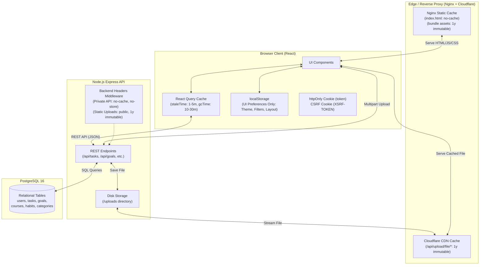

# Data Flow Architecture & Caching Map

This document maps all data across the **MasteryOS** application stack (PostgreSQL, Node.js/Express, React/Vite, Docker, Nginx, and Cloudflare), detailing where each data element currently lives, its optimal destination, whether and how it should be cached, and architectural problems identified during full codebase analysis.

---

## 1. Complete Data Mapping Table

| Data Name | Type | Where it lives now | Best place for it to live, and why | Can it be cached? | If yes: where, for how long, and refresh strategy |
| :--- | :--- | :--- | :--- | :--- | :--- |
| **`users` table (id, email, full_name, avatar_url, created_at, updated_at)** | DB record (UUID, strings, timestamps) | PostgreSQL database (`users` table) | PostgreSQL database. Master source of record for identity. | **Yes** | **React Query** (`['auth', 'me']`) in browser memory for 5–15 min (`staleTime: 5m`, `gcTime: 30m`). Invalidate on `updateProfile` / `changePassword`. Backend: `Cache-Control: private, no-cache` (never cache on Cloudflare or shared edge). |
| **`users.password_hash`** | String (bcrypt hash) | PostgreSQL database (`users` table) | PostgreSQL database only. Highly sensitive credential. | **No** | Must never be cached anywhere in browser or CDN memory. |
| **`users.settings` (themeMode, dashboardConfig, equippedTitleId)** | JSONB | PostgreSQL database (`users.settings` column) + duplicated in `localStorage` | PostgreSQL database as source of truth; synced to **React Query** / User Context. `localStorage` should only hold non-sensitive local device overrides. | **Yes** | **React Query** as part of `['auth', 'me']` (`staleTime: 10m`). Invalidate immediately on `updateSettings` mutation. Backend sends `Cache-Control: private, no-cache`. |
| **`users.token_version`** | Integer | PostgreSQL database (`users` table) | PostgreSQL database. Enforces instant token revocation and logout. | **No** | Evaluated on every authenticated request by backend JWT middleware. Never cached. |
| **`categories` table (id, user_id, name, color, created_at)** | DB records | PostgreSQL database (`categories` table) + duplicated in frontend `INITIAL_CATEGORIES` | PostgreSQL database. Dynamically queried per user. | **Yes** | **React Query** (`['categories']`) in browser memory for 10–30 min (`staleTime: 10m`). Invalidate on `createCategory` or `deleteCategory`. Backend: `Cache-Control: private, no-cache`. |
| **`goals` table (id, user_id, title, description, due_date, target_date, priority, color, icon, timestamps)** | DB records | PostgreSQL database (`goals` table) | PostgreSQL database. Core domain entity. | **Yes** | **React Query** (`['goals']`) in browser memory for 2–5 min (`staleTime: 2m`). Invalidate on goal create/update/delete or when linked tasks change. Backend: `Cache-Control: private, no-cache`. |
| **`courses` table (id, user_id, title, description, cover_image, finished_lessons, total_lessons, certification_url, certification_filename, timestamps)** | DB records | PostgreSQL database (`courses` table) | PostgreSQL database. | **Yes** | **React Query** (`['courses']`) in browser memory for 2–5 min (`staleTime: 2m`). Invalidate on course add/edit/delete/incrementLesson. Backend: `Cache-Control: private, no-cache`. |
| **`tasks` table (id, user_id, category_id, goal_id, course_id, title, description, status, priority, due_date, estimated_minutes, is_archived, timestamps)** | DB records | PostgreSQL database (`tasks` table) + duplicated in `localStorage` (`mastery_local_tasks_${userId}`) | PostgreSQL database. Single authoritative store. LocalStorage duplication should be eliminated. | **Yes** | **React Query** (`['tasks', { status, priority, categoryId, search, ... }]`) in browser memory with `staleTime: 1m`, `gcTime: 10m`. Invalidate on task create/update/status-change/delete. Optimistic UI update on status change. Backend: `Cache-Control: private, no-cache`. |
| **`task_activities` table (id, task_id, user_id, action_type, details, created_at)** | DB records | PostgreSQL database (`task_activities` table) | PostgreSQL database. Audit append-only trail. | **Yes** | **React Query** (`['tasks', taskId, 'activities']`) for 5 min. Invalidate on task edits or status transitions. Backend: `Cache-Control: private, no-cache`. |
| **`habits` table (id, user_id, title, description, icon, color, time_of_day, frequency, is_archived, timestamps)** | DB records | PostgreSQL database (`habits` table) | PostgreSQL database. | **Yes** | **React Query** (`['habits']`) for 2–5 min (`staleTime: 2m`). Invalidate on habit create/update/toggle/delete. Backend: `Cache-Control: private, no-cache`. |
| **`habit_logs` table (id, habit_id, user_id, completed_date, created_at)** | DB records | PostgreSQL database (`habit_logs` table) | PostgreSQL database. Tracks daily completion dates. | **Yes** | Combined with habits response in **React Query** (`['habits']`). Refreshed on `toggleHabit` with optimistic toggle update. Backend: `Cache-Control: private, no-cache`. |
| **Task Analytics / Stats (`GET /api/tasks/stats`)** | Aggregated Object (total, todo, in_progress, in_review, completed, urgent, overdue) | Calculated dynamically via SQL query in Node.js | Generated dynamically in PostgreSQL/Node.js. | **Yes** | **React Query** (`['tasks', 'stats']`) for 1–2 min (`staleTime: 1m`). Invalidate whenever any task is added, updated, or deleted. Backend: `Cache-Control: private, no-cache`. |
| **Current User Endpoint (`GET /api/auth/me`)** | Object (`{ user }`) | Generated dynamically in Node.js controller | Node.js Express controller reading verified user from DB. | **Yes** | **React Query** (`['auth', 'me']`) for 5–15 min. Invalidate on profile or settings update. Backend: `Cache-Control: private, no-cache, no-store`. |
| **Auth Tokens (JWT in Cookie `token`)** | String (Signed JWT) | HTTP Cookie (`token`, httpOnly, lax, secure in prod, maxAge 24h) | HTTP-only Cookie. Safest location against XSS. | **No** | Tokens are credentials, not cacheable payloads. Sent with each HTTP request. |
| **Auth CSRF Token (Cookie `XSRF-TOKEN` & Header `X-CSRF-Token`)** | String (Random hex) | HTTP Cookie + Header | Cookie (readable by JS) + Request Header. | **No** | Security token validated on state-changing requests. Never cached. |
| **Auth Token in LocalStorage (`master_tasks_token`)** | String (JWT) | Browser `localStorage` | **NOWHERE in `localStorage`**. Redundant and vulnerable to XSS. Auth should rely exclusively on the `httpOnly` cookie. | **No** | Security hazard; must be removed. |
| **Cached User Object in LocalStorage (`master_tasks_user`)** | Object (serialized JSON) | Browser `localStorage` | In **React Query** cache memory (`['auth', 'me']`). `localStorage` easily desyncs from DB updates. | **No** (in localStorage) | Cache in **React Query** memory only (`staleTime: 5m`). Refresh via `getMe()` query. |
| **Offline Mock Registered Users (`mastery_registered_users`)** | Array of Objects (with raw passwords!) | Browser `localStorage` | **NOWHERE in client storage**. Critical security vulnerability storing plaintext passwords. | **No** | Must be removed immediately. |
| **Offline Tasks Cache in LocalStorage (`mastery_local_tasks_${userId}`)** | Array of Objects | Browser `localStorage` | **React Query** client cache memory (with optional `@tanstack/react-query-persist-client` if offline support is required). | **Yes** | Managed by **React Query**. Invalidate automatically on mutations. |
| **Task Filter & View Preferences (`mastery_tasks_preferences`)** | Object (viewMode, statusFilter, priorityFilter, sortBy, groupBy, hideCompleted) | Browser `localStorage` | Browser `localStorage`. Good place for per-device view preferences. | **Yes** | Stored in **localStorage** indefinitely. Refreshed on user interaction in UI filters. |
| **Goal Filter Preferences (`mastery_goals_filters`)** | Object (sortBy, search, filters) | Browser `localStorage` | Browser `localStorage` for device preference. | **Yes** | Stored in **localStorage** indefinitely. Refreshed on UI filter toggle. |
| **Course Filter Preferences (`mastery_courses_filters`)** | Object (sortBy, search, filters) | Browser `localStorage` | Browser `localStorage` for device preference. | **Yes** | Stored in **localStorage** indefinitely. Refreshed on UI filter toggle. |
| **Dashboard Layout Configuration (`mastery_dashboard_config`)** | Object (order, showMetrics, showQuests, showTasks, showGoals, showCourses, showHabits) | Browser `localStorage` + DB `users.settings.dashboardConfig` | DB `users.settings` (primary across devices) + `localStorage` (fallback cache). | **Yes** | Stored in **React Query** (user settings) + **localStorage** as fallback. Refreshed on Settings save. |
| **Workspace Preference Toggle (`mastery_user_prefers_workspace`)** | String ('true'/'false') | Browser `localStorage` | Browser `localStorage` or `users.settings`. | **Yes** | Stored in **localStorage** indefinitely. Refreshed on user click. |
| **Theme Mode (`taskmaster_theme_mode` & legacy `taskmaster_theme`)** | String ('light', 'dark', 'system') | Browser `localStorage` + DB `users.settings.themeMode` | Browser `localStorage` (to prevent Flash of Unstyled Theme on initial HTML load) + DB `users.settings` (cross-device sync). | **Yes** | Stored in **localStorage** indefinitely. Refreshed on theme selector click. |
| **Equipped Gamification Title (`taskmaster_equipped_title_${userId}`)** | String (title ID) | Browser `localStorage` + DB `users.settings.equippedTitleId` | DB `users.settings` (primary) + **React Query** cache. | **Yes** | In **React Query** cache + **localStorage**. Invalidate on title equip. |
| **Acknowledged Level (`mastery_acknowledged_level_${userId}`)** | String / Integer | Browser `localStorage` | Browser `localStorage` or DB `users.settings.acknowledgedLevel`. | **Yes** | In **localStorage** / DB settings. Refreshed on level-up modal close. |
| **Legacy Local Habits Key (`mastery_local_habits`)** | Array of Objects | Browser `localStorage` (referenced in cleanups) | Obsolete. DB `habits` table is authoritative. | **No** | Delete key; no longer used. |
| **Uploaded User Files (Images, Certificate PDFs)** | Binary Files (PNG, JPG, WEBP, PDF) | Disk file system (`backend/uploads/`) | Disk file system or Object Storage (S3 / R2 / Docker volume), served via `/api/upload/file/:filename`. | **Yes** | **Browser & Cloudflare / Nginx** for **1 year** (`Cache-Control: public, max-age=31536000, immutable`). Filenames use UUID hashes, making them permanently immutable. Refresh: new file gets a new UUID. |
| **Course Cover Images & Certificates (Client Base64 Data URLs)** | String (Base64 data URL up to 8MB) | In-memory React State (`CourseModal.jsx`), sent as JSON body | **File System / Backend Upload Volume**. Should NOT be stored as base64 in PostgreSQL text columns. Must use `/api/upload`. | **Yes (once converted to static URL)** | Once uploaded to `/api/upload`, cached via **Cloudflare / Browser** for 1 year (`immutable`). |
| **Avatar Photos (Settings Base64 Data URLs)** | String (Base64 data URL) | In-memory React State (`SettingsPage.jsx`), sent to DB `avatar_url` | **File System / Backend Upload Volume** via `/api/upload`, returning a static `/api/upload/file/:filename` URL. | **Yes (once converted to static URL)** | Once stored as static asset: **Browser & Cloudflare** for 1 year (`immutable`). |
| **Frontend Production Bundles (`dist/assets/*.js`, `dist/assets/*.css`)** | Static compiled code files | Disk (`frontend/dist/assets/`), served by Nginx | Nginx container file system / Cloudflare Edge CDN. | **Yes** | **Cloudflare & Browser** for **6 months to 1 year** (`Cache-Control: public, max-age=31536000, immutable`). Bundles contain content hashes. Refresh: automatic when new build generates new hashes. |
| **Frontend Root Entry (`index.html`)** | HTML Document | Disk (`frontend/dist/index.html`), served by Nginx | Nginx container file system. | **Yes (with strict revalidation)** | **Browser**: `Cache-Control: no-cache, must-revalidate` (or `max-age=0, must-revalidate`). Must revalidate with ETag on every load so new asset hashes take effect immediately upon deployment. |
| **Public Static Assets (`favicon.svg`, `icons.svg`, `hero.png`)** | Static SVG / PNG files | `frontend/public/` and `frontend/src/assets/` | Nginx container file system / Cloudflare Edge CDN. | **Yes** | **Cloudflare & Browser** for **30 days to 6 months** (`Cache-Control: public, max-age=2592000`). Refresh: cache bust via asset versioning or filename update. |
| **External Fonts (Google Fonts & Gstatic CDN)** | CSS stylesheets and WOFF2 font files | External Google CDN (`fonts.googleapis.com`, `fonts.gstatic.com`) | External Google CDN or self-hosted in `/assets/fonts/`. | **Yes** | Handled by **Google CDN & Browser** (`max-age=31536000` for font binaries). |
| **External DiceBear Avatars (`https://api.dicebear.com/7.x/...`)** | SVG Image | External DiceBear API | External CDN or cached locally in `/api/upload`. | **Yes** | **Browser & Cloudflare**: cached for 7–30 days based on deterministic URL seed. |
| **Database Credentials (`DB_USER`, `DB_PASSWORD`, `DB_NAME`, `DB_HOST`, `DB_PORT`)** | Strings / Integers | Backend Environment Variables (`.env`, `docker-compose.yml`) | Backend Environment / Docker Secrets. Never exposed to browser. | **No** | Loaded into Node process memory on boot. Never cached. |
| **JWT Configuration (`JWT_SECRET`, `JWT_EXPIRES_IN`)** | Strings | Backend Environment Variables (`.env`, `docker-compose.yml`) | Backend Environment / Docker Secrets. | **No** | Kept in Node process memory. Never cached. |
| **API Port & Node Environment (`PORT`, `NODE_ENV`)** | String / Integer | Backend Environment Variables | Backend Environment. | **No** | Node process memory on boot. |
| **CORS Origins & Proxy Config (`ALLOWED_ORIGINS`, `TRUST_PROXY`)** | Strings | Backend Environment Variables | Backend Environment. | **No** | Node process memory on boot. |
| **File Upload Directory (`UPLOAD_DIR`)** | String (File path) | Backend Environment Variables | Backend Environment. | **No** | Node process memory on boot. |
| **Rate Limit & Lockout Thresholds (`AUTH_RATE_LIMIT_MAX`, `LOCKOUT_DURATION_MS`, etc.)** | Numbers | Backend Environment Variables | Backend Environment. | **No** | Node process memory on boot. |
| **Cloudflare Tunnel Token (`CLOUDFLARE_TUNNEL_TOKEN`)** | String (Secret token) | Root `.env` / `docker-compose.yml` | Cloudflare daemon container environment. | **No** | Container environment only. |
| **Frontend API Base URL (`VITE_API_URL`)** | String URL | Frontend build-time env / Vite env | Vite build-time environment variable. | **Yes** | Inlined into frontend bundle during `vite build`. Cached with bundle. |
| **Gamification Rules & Levels (`LEVELS`)** | Array of Objects (8 tiers, XP ranges, badges) | Frontend hardcoded (`frontend/src/services/gamification.js`) | Static module in frontend bundle (or DB if dynamic level configuration is needed in the future). | **Yes** | Cached in **Frontend bundle** in browser/CDN. Refreshed on application rebuild. |
| **Gamification Achievements (`TRACK_ACHIEVEMENTS`)** | Object with arrays of rule definitions | Frontend hardcoded (`frontend/src/services/gamification.js`) | Static module in frontend bundle. | **Yes** | Cached in **Frontend bundle**. Refreshed on application rebuild. |
| **Calculated Gamification Stats (`playerStats`)** | Derived Object (level, XP progress, unlocked achievements, title) | In-memory React State / derived via `calculateGamification()` | Derived in **GamificationContext** using React Query cache (`tasks`, `goals`, `courses`, `habits`). | **Yes** | Memoized in **React memory** via `useMemo`. Automatically recomputed whenever React Query data updates. |
| **Frontend Initial Categories Fallback (`INITIAL_CATEGORIES`)** | Array of Objects (`cat-1` to `cat-4`) | Frontend hardcoded (`frontend/src/App.jsx`) | **PostgreSQL database**. Should not be hardcoded in frontend with mock non-UUID IDs. | **Yes (from DB)** | Remove hardcoded array; fetch from DB and cache in **React Query** (`['categories']`). |
| **Backend Seed Defaults (Categories, Goals, Courses, Habits)** | Array of Objects | Backend model seed functions (`*.model.js`) | Backend seed files / database initialization migration. | **No** | Seeded into DB on first user creation. DB records are cached via React Query. |
| **Backend In-Memory Fallback Maps (`fallbackUsers`, `fallbackTasks`, etc.)** | Maps (`new Map()`) | Node.js process memory in backend models | PostgreSQL database. In-memory fallbacks cause data desynchronization across container restarts. | **No** | Ephemeral process memory. Should not be used in place of PostgreSQL. |
| **Account Lockout & Failed Logins Map** | Map (`failedAttempts = new Map()`) | Node.js process memory (`accountLockout.js`) | Node.js process memory (or Redis for multi-instance clusters). | **No** | Ephemeral security tracking with time-based auto-expiry (15 min). |
| **Rate Limiter Hit Counters** | Map / In-memory store | Node.js process memory (`express-rate-limit`) | Node.js process memory (or Redis for distributed clusters). | **No** | Ephemeral window tracking (15 min). |
| **Global React Entity State (`tasks`, `goals`, `courses`, `habits`, `categories`, `stats`)** | State variables in `AuthenticatedApp` (`App.jsx`) | Top-level React `useState` in `App.jsx`, prop-drilled down | **React Query Cache** (`QueryClient`). Eliminates prop drilling, `reloadTrigger`, and manual sync loops. | **Yes** | **React Query Client Cache** in browser memory. Individual queries have dedicated `staleTime` (1–5 min) and automated invalidation on mutations. |
| **React Modal Open & Editing States** | Booleans and Selected Objects | React `useState` in `App.jsx` and pages | Local component state or a lightweight UI store (e.g., Zustand / UI Context). | **No** | Ephemeral UI interaction state. |
| **Page-Level Search & Filter States** | Strings, Booleans, Enums | React `useState` in page components (`TasksPage`, `GoalsPage`, etc.) | URL Query Parameters (`useSearchParams`) and Component State. | **No** (as cache) | Persisted in URL params or `localStorage` preferences. |

---

## 2. Problems Found

During the comprehensive analysis of the codebase, two categories of issues were identified:
1. **Critical architectural, security, and caching defects** (data stored in the wrong place or missing cache controls).
2. **Data in the right primary store but fragmented, duplicated, or needing enhancement** (such as `users.settings` in PostgreSQL JSONB being split and duplicated across 5+ `localStorage` keys).

---

### Part A: Data in the Wrong Place & Security Defects

#### 1. Plaintext Passwords Stored in Client `localStorage` (Critical Security Risk)
* **Location:** [`frontend/src/context/AuthContext.jsx`](file:///c:/Users/PC/Desktop/React%20Projects/frontend/src/context/AuthContext.jsx#L94-L118) and [`AuthContext.jsx:L142-L179`](file:///c:/Users/PC/Desktop/React%20Projects/frontend/src/context/AuthContext.jsx#L142-L179)
* **Issue:** In the offline fallback handler, whenever registration or login occurs without server connectivity, user objects are serialized into `localStorage.setItem('mastery_registered_users', ...)` with unhashed, raw plaintext passwords (`password: password`).
* **Risk:** Any client-side script, third-party dependency, browser extension, or XSS flaw can access `localStorage` and extract plaintext user credentials.

---

#### 2. Redundant JWT Storage in `localStorage` Bypassing HTTP-Only Cookie Protections
* **Location:** [`frontend/src/context/AuthContext.jsx:L76`](file:///c:/Users/PC/Desktop/React%20Projects/frontend/src/context/AuthContext.jsx#L76), [`frontend/src/services/api.js:L10`](file:///c:/Users/PC/Desktop/React%20Projects/frontend/src/services/api.js#L10)
* **Issue:** The backend already issues an `httpOnly`, `secure`, `sameSite: 'lax'` cookie named `token`. However, the frontend also stores the raw JWT in `localStorage.setItem('master_tasks_token', data.token)` and attaches an `Authorization: Bearer <token>` header to all requests.
* **Risk:** Storing JWTs in `localStorage` negates the primary defense of `httpOnly` cookies (protection against token theft via XSS). Furthermore, on password change, the backend clears the cookie, but `master_tasks_token` remains in `localStorage`, leading to auth desynchronization.

---

#### 3. File Uploads Bypassing Backend Upload Endpoint with Giant Base64 Strings
* **Location:** [`frontend/src/components/courses/CourseModal.jsx:L66-L90`](file:///c:/Users/PC/Desktop/React%20Projects/frontend/src/components/courses/CourseModal.jsx#L66-L90), [`frontend/src/pages/SettingsPage.jsx:L119-L124`](file:///c:/Users/PC/Desktop/React%20Projects/frontend/src/pages/SettingsPage.jsx#L119-L124)
* **Issue:** The backend has a dedicated, secure multipart file upload route at `/api/upload` ([`backend/src/routes/upload.routes.js`](file:///c:/Users/PC/Desktop/React%20Projects/backend/src/routes/upload.routes.js)) that validates magic numbers and persists files to disk. However, the frontend **never calls this endpoint**. Instead, it uses `FileReader.readAsDataURL()` to encode course cover images, 8MB certificate PDFs, and avatar photos into gigantic Base64 strings.
* **Risk:**
  1. The backend enforces `app.use(express.json({ limit: '100kb' }))` in [`backend/src/app.js:L131`](file:///c:/Users/PC/Desktop/React%20Projects/backend/src/app.js#L131). Uploading an image or PDF over ~75KB will immediately trigger an HTTP 413 `Payload Too Large` error.
  2. Base64 strings in PostgreSQL inflate database size exponentially and cannot be cached effectively by CDNs or browser disk caches.

---

#### 4. Missing `Cache-Control` Headers on Static Uploaded Files
* **Location:** [`backend/src/routes/upload.routes.js:L82-L123`](file:///c:/Users/PC/Desktop/React%20Projects/backend/src/routes/upload.routes.js#L82-L123)
* **Issue:** The static file delivery endpoint `GET /api/upload/file/:filename` streams files from disk using UUID-based random filenames (e.g., `4a2f8b9e...png`). Because these filenames are cryptographically unique and immutable, they should be permanently cached. However, **no `Cache-Control` header is set at all**.
* **Impact:** Browsers and Cloudflare repeatedly re-download entire images and PDFs on every page visit, wasting bandwidth and degrading render performance.

---

#### 5. Missing `Cache-Control` Directives on Authenticated API Routes
* **Location:** [`backend/src/app.js`](file:///c:/Users/PC/Desktop/React%20Projects/backend/src/app.js) and all route files (`task.routes.js`, `goal.routes.js`, etc.)
* **Issue:** None of the Express endpoints declare explicit caching headers such as `Cache-Control: private, no-cache, no-store, must-revalidate`.
* **Impact:** Without explicit directives, reverse proxies (Nginx, Cloudflare Tunnel) or aggressive browser heuristics could potentially cache private user data or serve stale responses across sessions.

---

#### 6. Missing Cache Invalidation / Revalidation for SPA `index.html` in Nginx
* **Location:** [`frontend/nginx.conf:L28-L30`](file:///c:/Users/PC/Desktop/React%20Projects/frontend/nginx.conf#L28-L30)
* **Issue:** While static assets matching extensions (`.js`, `.css`, etc.) receive `Cache-Control: "public, max-age=15552000, immutable"`, the fallback `location / { try_files $uri $uri/ /index.html; }` does not set `Cache-Control: no-cache, must-revalidate`.
* **Impact:** If `index.html` is cached by client browsers, deploying a new build with new hashed asset filenames causes returning users to load an outdated `index.html` pointing to nonexistent old bundle chunks.

---

#### 7. Conflicting Ad-Hoc Task Cache in `localStorage` (`mastery_local_tasks_${userId}`)
* **Location:** [`frontend/src/App.jsx:L37-L58`](file:///c:/Users/PC/Desktop/React%20Projects/frontend/src/App.jsx#L37-L58), [`App.jsx:L124-L155`](file:///c:/Users/PC/Desktop/React%20Projects/frontend/src/App.jsx#L124-L155)
* **Issue:** `App.jsx` attempts to implement its own custom offline synchronization layer by caching tasks in `localStorage`, generating fake IDs like `local-task-171...`, and running background synchronization loops on mount.
* **Impact:** This causes race conditions, phantom duplicate tasks, and synchronization conflicts across browser tabs. This entire custom caching layer should be replaced by React Query's declarative cache.

---

#### 8. Hardcoded Category Mock IDs (`cat-1` to `cat-4`) Clashing with Database UUIDs
* **Location:** [`frontend/src/App.jsx:L30-L35`](file:///c:/Users/PC/Desktop/React%20Projects/frontend/src/App.jsx#L30-L35), [`App.jsx:L245-L257`](file:///c:/Users/PC/Desktop/React%20Projects/frontend/src/App.jsx#L245-L257)
* **Issue:** The frontend hardcodes `INITIAL_CATEGORIES` with string IDs (`cat-1`, `cat-2`, `cat-3`, `cat-4`). However, PostgreSQL enforces strict `UUID` types on `categories.id` and `tasks.category_id`. The codebase requires fragile mapping code (`categoryMap`, `defaultNameMap`) to prevent SQL UUID syntax errors.
* **Impact:** The database already has a backend category seeder that creates valid UUID categories for each user upon creation. The hardcoded frontend mock IDs are redundant and bug-prone.

---

#### 9. Monolithic State and Manual Refetch Triggers in `App.jsx`
* **Location:** [`frontend/src/App.jsx:L74-L174`](file:///c:/Users/PC/Desktop/React%20Projects/frontend/src/App.jsx#L74-L174)
* **Issue:** `AuthenticatedApp` maintains six separate entity states (`tasks`, `goals`, `courses`, `habits`, `categories`, `stats`) and relies on a manual `reloadTrigger` counter and `Promise.allSettled` to refresh all six endpoints at once.
* **Impact:** Updating or toggling a single habit or task either requires manual prop-drilling through every screen or forces a re-render of the entire authenticated component tree. React Query will allow individual components and hooks (`useTasks`, `useGoals`, etc.) to query and subscribe to their own granular cached data.

---

#### 10. In-Memory Fallback Stores in Backend Controllers Causing Data Ghosting
* **Location:** Backend models (`task.model.js:L5`, `habit.model.js:L5`, `user.model.js:L5`, `goal.model.js:L5`, `course.model.js:L5`, `category.model.js:L5`)
* **Issue:** When database queries fail in non-production environments, the backend silently falls back to module-level `Map` instances (`fallbackTasks = new Map()`, etc.).
* **Impact:** If the PostgreSQL container temporarily resets or disconnects, operations succeed in memory and report success to the frontend, but data vanishes upon Node restart, giving developers and users a false impression that data is persisted.

---

### Part B: Data in the Right Core Store but Fragmented, Duplicated, or Needing Enhancement

#### 11. Fragmented & Duplicated `users.settings` across Multiple `localStorage` Keys
* **Location:** PostgreSQL `users.settings` column vs. [`AuthContext.jsx:L42-L52`](file:///c:/Users/PC/Desktop/React%20Projects/frontend/src/context/AuthContext.jsx#L42-L52), [`SettingsPage.jsx:L88`](file:///c:/Users/PC/Desktop/React%20Projects/frontend/src/pages/SettingsPage.jsx#L88), [`DashboardPage.jsx:L76`](file:///c:/Users/PC/Desktop/React%20Projects/frontend/src/pages/DashboardPage.jsx#L76), [`ThemeContext.jsx:L14`](file:///c:/Users/PC/Desktop/React%20Projects/frontend/src/context/ThemeContext.jsx#L14), [`GamificationContext.jsx:L11`](file:///c:/Users/PC/Desktop/React%20Projects/frontend/src/context/GamificationContext.jsx#L11)
* **The Situation:** User preferences correctly belong in the PostgreSQL database (`users.settings` JSONB) for reliable persistence across devices and browsers. However, the client fragments this single settings object into 5+ disparate `localStorage` keys:
  - `taskmaster_theme_mode`
  - `taskmaster_theme` (legacy key)
  - `mastery_dashboard_config`
  - `taskmaster_equipped_title_${userId}`
  - `taskmaster_equipped_title` (legacy/guest key)
  - `mastery_acknowledged_level_${userId}`
* **Why It Needs Enhancement:**
  1. To keep them in sync, the code dispatches custom DOM window events (`window.dispatchEvent(new CustomEvent('taskmaster_settings_sync'))`, `mastery_dashboard_config_sync`, `taskmaster_title_sync`) and registers window storage/focus listeners.
  2. If a user modifies their settings on one device or tab, the disparate `localStorage` keys become desynchronized, leading to conflicting states or overwriting user preferences with stale local values.
* **Enhancement:** Treat `users.settings` fetched via **React Query** (`['auth', 'me']` or a dedicated `useSettings` query) as the single source of truth. Keep `localStorage` strictly as an initial read-only bootstrap cache (primarily for theme mode to avoid a Flash of Unstyled Theme before auth loads), and eliminate the complex web of custom window events and duplicate local storage writes.

---

#### 12. Stale User Profile Object Duplicated in `localStorage` (`master_tasks_user`)
* **Location:** [`frontend/src/context/AuthContext.jsx:L15`](file:///c:/Users/PC/Desktop/React%20Projects/frontend/src/context/AuthContext.jsx#L15), [`AuthContext.jsx:L39`](file:///c:/Users/PC/Desktop/React%20Projects/frontend/src/context/AuthContext.jsx#L39), [`AuthContext.jsx:L77`](file:///c:/Users/PC/Desktop/React%20Projects/frontend/src/context/AuthContext.jsx#L77)
* **The Situation:** The user profile (`id`, `full_name`, `email`, `avatar_url`) correctly lives in PostgreSQL `users`. The client caches this in `localStorage.setItem('master_tasks_user', JSON.stringify(res.user))` to initialize the UI before network requests finish.
* **Why It Needs Enhancement:**
  - Manually keeping a stringified user object in `localStorage` updated across `login`, `register`, `updateProfile`, and `updateSettings` is error-prone.
  - If a user changes their name or avatar in another session, `master_tasks_user` displays stale profile data until hard refreshed.
* **Enhancement:** Let **React Query** manage the authenticated user in client memory via `useQuery({ queryKey: ['auth', 'me'], queryFn: api.getMe })`. The React Query cache automatically handles background revalidation, garbage collection, and optimistic profile updates without manual `localStorage` serialization.

---

#### 13. Duplicated Habit Streak Calculation Logic (Client vs. Server Drift)
* **Location:** Backend [`backend/src/models/habit.model.js:L37-L106`](file:///c:/Users/PC/Desktop/React%20Projects/backend/src/models/habit.model.js#L37-L106) (`calculateStreaks`) vs. Frontend [`frontend/src/utils/habitUtils.js:L46-L122`](file:///c:/Users/PC/Desktop/React%20Projects/frontend/src/utils/habitUtils.js#L46-L122) (`computeHabitStreak` & `calculateHabitStats`)
* **The Situation:** Habit completion logs live properly in PostgreSQL `habit_logs`. However, the calculation of consecutive day streaks, current streak, and longest streak is implemented twice in full: once in Node.js and once in browser JavaScript.
* **Why It Needs Enhancement:**
  - While client-side calculation was added for optimistic UI updates, differences in timezone conversions (`new Date()` noon vs UTC shifts) between Node.js server time and browser local time cause streak discrepancies (e.g., streak shows 5 days on client, then jumps to 4 days after server re-sync).
* **Enhancement:** Establish the backend as the authoritative computation engine. The frontend React Query mutation for `toggleHabit` can optimistically toggle the date key in the habit's `completed_dates` array, while the server's authoritative streak response seamlessly settles into the React Query cache on resolution.

---

#### 14. Conflicting Dual Source of Truth for Task Analytics (`/api/tasks/stats` vs. Client Filter)
* **Location:** Backend [`backend/src/models/task.model.js:L352-L386`](file:///c:/Users/PC/Desktop/React%20Projects/backend/src/models/task.model.js#L352-L386) (`getAnalytics`) vs. Frontend [`frontend/src/pages/AnalyticsPage.jsx:L18-L38`](file:///c:/Users/PC/Desktop/React%20Projects/frontend/src/pages/AnalyticsPage.jsx#L18-L38)
* **The Situation:** The backend provides a dedicated, highly optimized SQL aggregation endpoint `GET /api/tasks/stats` that counts total, todo, in-progress, completed, urgent, and overdue tasks using database indexes.
* **Why It Needs Enhancement:**
  - `AnalyticsPage.jsx` checks: `const total = tasks.length > 0 ? tasks.length : (stats.total || 0);` and manually re-filters the `tasks` array for all metrics.
  - If tasks are paginated (the backend controller limits queries to 50–100 tasks by default) or filtered by category/status, the client-calculated stats reflect only the loaded subset rather than the user's complete operational totals, conflicting with the true server statistics.
* **Enhancement:** Use React Query's `useQuery({ queryKey: ['tasks', 'stats'], queryFn: api.getStats })` as the single authoritative source of truth for all global analytics metrics across both `DashboardPage` and `AnalyticsPage`. Invalidate `['tasks', 'stats']` whenever task mutations occur.

---

#### 15. UI Filter & Sort Preferences Trapped in `localStorage` instead of URL Parameters
* **Location:** [`TasksPage.jsx:L20`](file:///c:/Users/PC/Desktop/React%20Projects/frontend/src/pages/TasksPage.jsx#L20) (`mastery_tasks_preferences`), [`GoalsPage.jsx:L26`](file:///c:/Users/PC/Desktop/React%20Projects/frontend/src/pages/GoalsPage.jsx#L26) (`mastery_goals_filters`), [`CoursesPage.jsx:L23`](file:///c:/Users/PC/Desktop/React%20Projects/frontend/src/pages/CoursesPage.jsx#L23) (`mastery_courses_filters`)
* **The Situation:** Storing user view options (Kanban vs List, priority filter, sort order) in `localStorage` is logical for persisting personal UI preferences across visits.
* **Why It Needs Enhancement:**
  - Because filter and search state is saved solely in `localStorage` and component `useState`, users cannot share deep links to filtered task views (e.g. `?status=IN_PROGRESS&priority=URGENT`), and the browser's Back and Forward navigation buttons do not reflect filter history.
* **Enhancement:** Synchronize filter and sort parameters with URL Search Params (`useSearchParams` / React Router), using `localStorage` solely as an initial fallback when no query string exists in the URL.

---

#### 16. Base64 Avatar Strings Stored in PostgreSQL `users.avatar_url` Text Column
* **Location:** [`frontend/src/pages/SettingsPage.jsx:L119-L133`](file:///c:/Users/PC/Desktop/React%20Projects/frontend/src/pages/SettingsPage.jsx#L119-L133) storing `data:image/png;base64,...` into DB `avatar_url`
* **The Situation:** Storing an avatar URL in `users.avatar_url` is standard practice. However, when users upload a custom photo in `SettingsPage`, the file is read as a Base64 string and written directly into the PostgreSQL text column.
* **Why It Needs Enhancement:**
  - A Base64-encoded image can be 1–3 MB. Storing it directly in the `users` row bloats every database query that fetches user records (`findUserById`, JWT token verification, auth endpoints) and inflates the response payload of `GET /api/auth/me`.
  - Base64 data URLs cannot be cached by the browser cache or Cloudflare CDN because they are embedded inline in JSON API responses rather than referenced as separate static file URLs.
* **Enhancement:** Connect avatar uploads to the multipart `/api/upload` endpoint, store the binary image in the uploads directory, and store only the lightweight URL reference (`/api/upload/file/<uuid>.png`) in `users.avatar_url`. This allows the avatar to be cached by browsers and Cloudflare for up to 1 year with `Cache-Control: public, max-age=31536000, immutable`.

---

## 3. Recommended Architectural Target with React Query & Cache-Control

